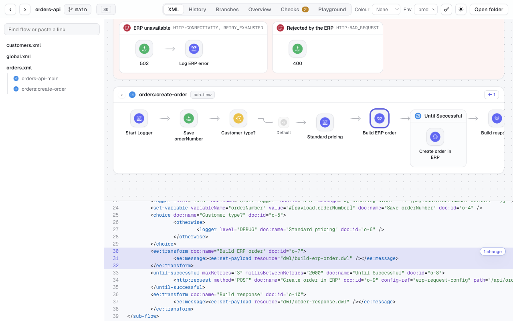
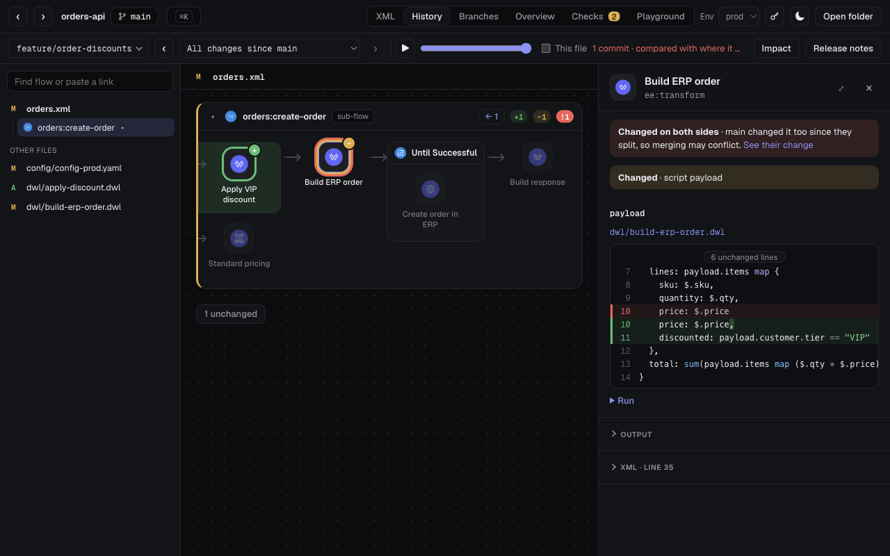
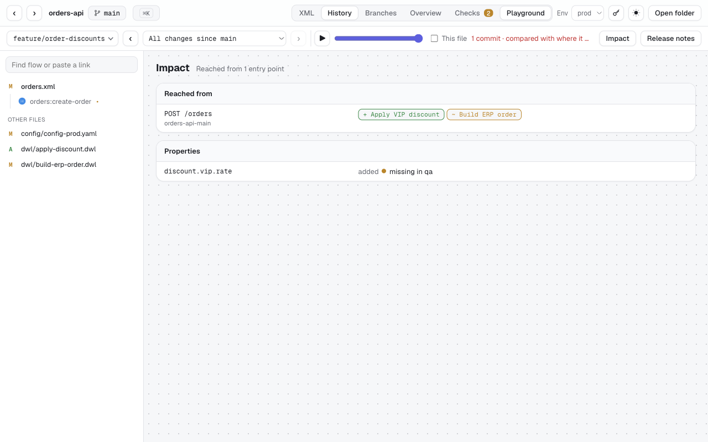
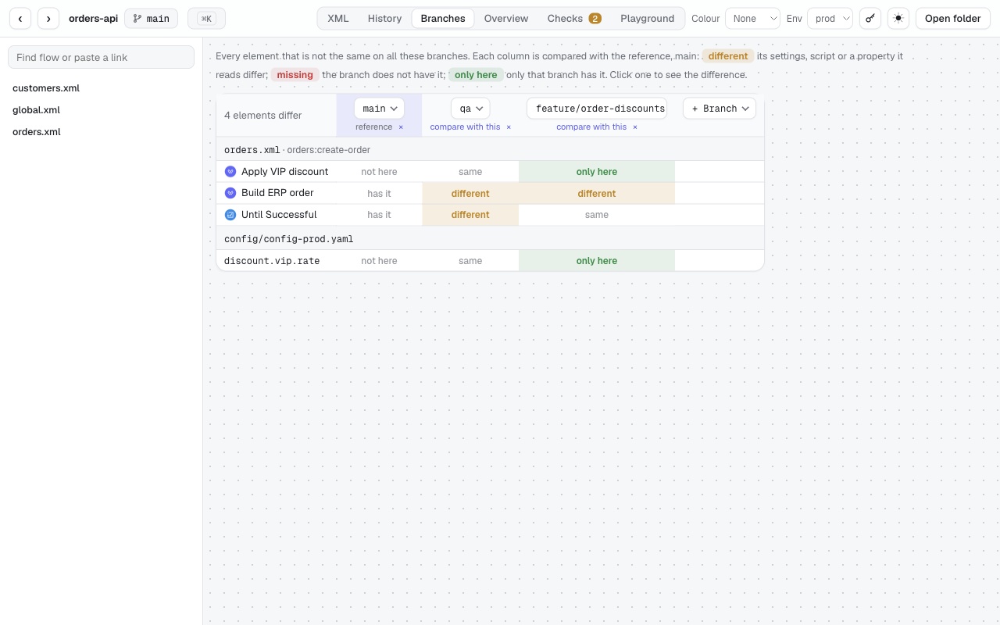
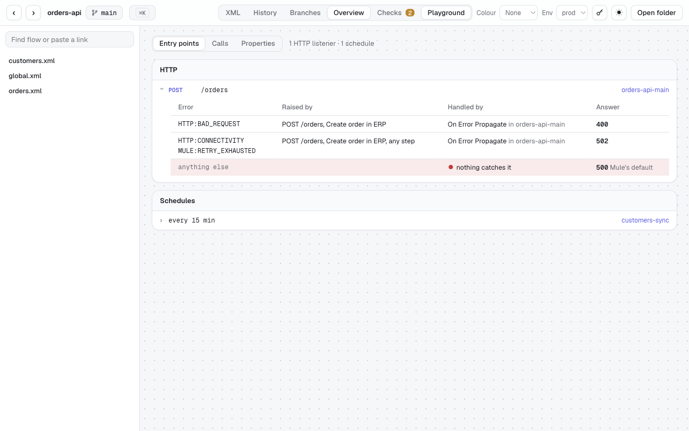
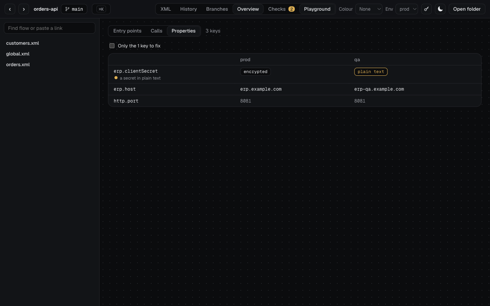
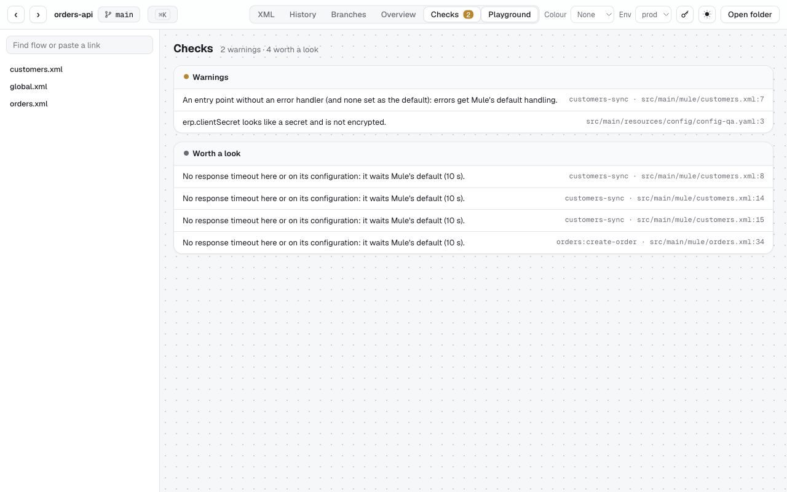
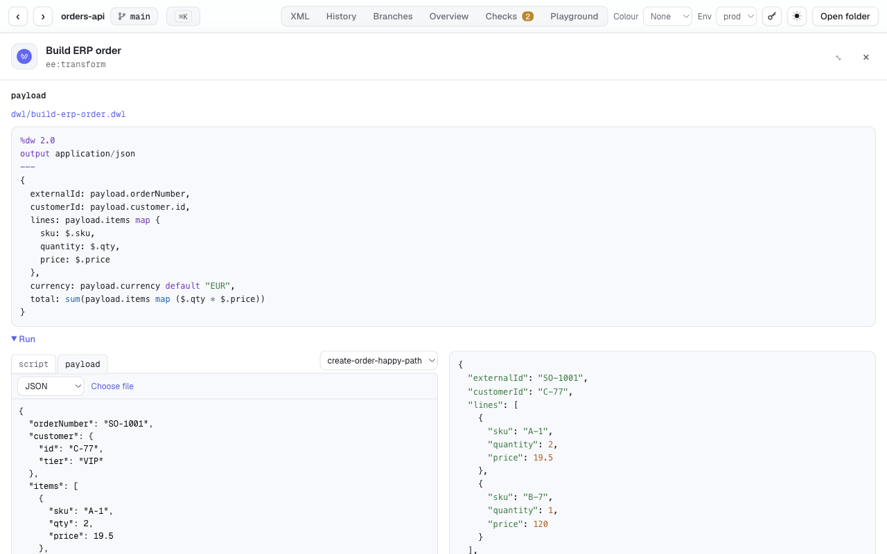
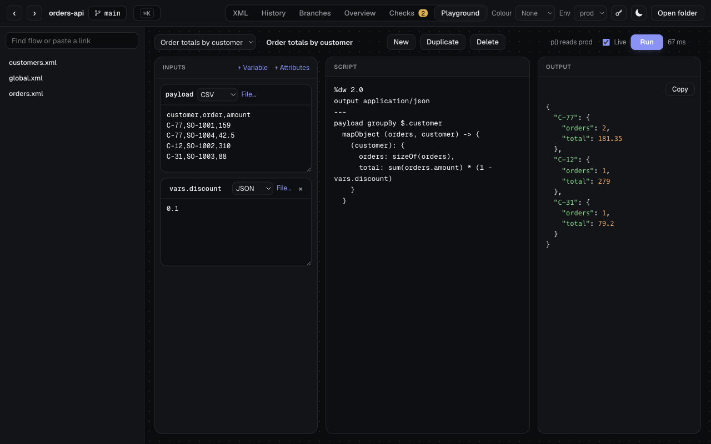

# Mule Flow Viewer

A Chrome extension that shows Mule 4 projects the way Anypoint Studio draws them, straight from Azure DevOps,
GitHub, GitLab or Bitbucket. Open a repository, a file, a branch or a pull request, click the extension's button, and
you get the flows, their history, what a change affects, and the app's endpoints, errors and properties per
environment. You don't need a clone, Studio or Maven.



- [Install](#install)
- [Open a project](#open-a-project)
- [What it shows](#what-it-shows)
- [The local helper (optional)](#the-local-helper-optional)
- [Privacy and security](#privacy-and-security)
- [Development](#development)

## Install

**From a release:** download `mule-flow-viewer-<version>.zip` from
[Releases](https://github.com/mak140430/mule-flow-viewer/releases) and unzip it. Then, in Chrome:
1. Open `chrome://extensions`.
2. Turn on **Developer mode**.
3. Click **Load unpacked** and choose the `extension` folder.

Edge, Brave and other Chromium browsers work the same way.

**From source:** `python3 tools/build_extension.py`, then load `dist/mule-flow-viewer/extension` the same way.

When it's installed, a short setup guide opens. For the four code hosts, nothing else is needed.

## Open a project

1. Go to a Mule project's page on Azure DevOps, GitHub, GitLab or Bitbucket. Any page works: the repository, a
   file, a branch, a commit or a pull request.
2. Click the extension's button, press **Alt+Shift+M**, or right-click the page and choose **Open in Mule Flow Viewer**.

The viewer opens in a new tab:
- **Page:** it shows the branch the page shows, and the file and lines it points at.
- **Pull request:** it opens as a merge preview of the source branch into the target.
- **Sign-in:** it reads the repository with the browser's existing sign-in. GitHub is the exception: its API
  ignores browser sign-ins, so it asks once for a read-only token.

**Moving around:**
- **⌘K** (Ctrl+K) opens a palette with flows, files, branches, tags and commands. You can also paste a link
  from any code host into it.
- **Find flow** in the sidebar searches flow names and the text of every file.
- Links are shareable: the address holds the file, flow, selection, comparison and view.

## What it shows

### Flows

Every flow, sub-flow, scope, router and error handler, with Studio's icons.
- **Details:** click a component to see its settings, `${...}` values for the selected environment (**Env** in the
  toolbar), and its DataWeave.
- **Flow references:** click one to jump to its target.
- **Callers:** `← N` on a flow lists what calls it: flow references, APIkit routes and `lookup()` calls.
- **Shared libraries:** flows in a shared library (a `mule-plugin` dependency) are read from the library's own
  repository, at the version the pom.xml uses.

**XML** in the toolbar shows the file under the canvas, linked both ways: select lines and their elements are
highlighted; click an element and its lines are marked.

### History and pull requests



**History** opens a bar where you pick a branch and a commit, or **All changes since main** (what a pull request
shows).
- **Canvas:** only changed flows show. Added elements are marked `+`, removed `−` and changed `~`.
- **Scripts and properties:** a transform counts as changed when its `.dwl` file changes, and an element counts as
  changed when a property it reads changes value.
- **Conflicts:** in a merge preview, elements the other branch changed differently are ringed in red.
- **Details:** a changed element shows its attribute, script and XML diffs.
- **This file:** limits the commits to the open file. ▶ replays them one by one.
- **Release notes:** the comparison as Markdown: flows, scripts, properties, library upgrades and commits.

**Element history:** with the XML open, the selected element's lines get a button such as
`3 changes · 2 branches`. It lists the branches where that element differs and the commits that changed it.

**Colour** rings every element by when it last changed, or by who changed it.

### Impact of a change



**Impact** (in the History bar) lists the entry points that run something the comparison changes, following flow
references, APIkit routes, error handlers and library flows:
- HTTP listeners
- each APIkit resource
- schedules
- other listeners

It also lists:
- properties the change adds or starts reading, and the environments that lack them
- dependency version changes
- changed global configurations

### Branches side by side



**Branches** puts one branch per column and one row per element or property value that differs, each compared with
the first column. It shows whether a change has reached qa, preprod or main. Click a cell to open that
comparison.

### Overview: entry points, calls and properties



**Overview** in the toolbar has three tabs:
- **Entry points:** every HTTP path, APIkit resource, schedule and listener. Open one to see:
  - the errors that can reach it
  - which handlers take each error, in order
  - the HTTP status it answers with
- **Calls:** each connector configuration the app uses to reach other systems, with its settings resolved for the
  selected environment, and the operations that use it.
- **Properties:** every key in each environment.



The Properties tab flags four kinds of key:
- read, but defined in no file
- missing in some environments
- a secret kept in plain text
- defined, but nothing reads it

On a code host, a fourth tab, **Libraries**, lists every shared library of the organization: the version each app
uses, and which apps are behind.

### Checks



**Checks** lists what is worth a second look, and marks errors and warnings on the canvas:
- calls to flows or configurations that don't exist
- missing DataWeave files
- secrets in XML or in plain property files
- loggers that write whole payloads
- entry points without error handling
- hard-coded hosts
- requests on Mule's default timeout
- flows and properties nothing uses

**Trace** (in a flow's details) lists every step as Mule runs it, into the flows it calls, with the variables each
step sets and reads. A variable read before anything sets it is flagged.

### DataWeave



With the [local helper](#the-local-helper-optional) and the
[DataWeave CLI](https://github.com/mulesoft/data-weave-cli), every script has a **Run** block.
- **Inputs from MUnit tests:** pick a test. The flow runs from the test's event up to the script, using its mocks.
- **Editing:** edit the script or the inputs and run again. **Live** reruns after every change.
- **Comparisons:** a changed transform runs both versions on the same inputs and compares the outputs.
- **Playground** in the toolbar is a full page for your own scripts. They can import the project's modules and read
  its properties.



### Images

A flow's details have **Copy image**, **PNG** and **SVG**, drawn exactly as on the canvas, for documents and
tickets.

### Secure properties

The key button next to **Env** takes the key for the project's `<secure-properties:config>`. Encrypted `![...]` values
are then decrypted in the page, and DataWeave runs receive them like any other property. Supported algorithms:
- AES (16-, 24- and 32-character keys)
- Rijndael
- Blowfish
- DES
- DESede

All four modes work (CBC, CFB, ECB and OFB), with or without random IVs. Rarer algorithms are reported rather than
guessed.

### Search every branch

In ⌘K, type text and choose **Search every branch**. It shows every matching line on every branch, grouped by file,
with the branches that have it.

## The local helper (optional)

The helper is a small Python program on your computer that Chrome talks to directly. It's needed for two things:
- **Running DataWeave** (Run blocks, MUnit inputs, output comparison, the Playground). This uses MuleSoft's
  [DataWeave CLI](https://github.com/mulesoft/data-weave-cli), which runs only as a program, not in a web page.
- **Self-hosted servers** (GitHub Enterprise, your own GitLab or Bitbucket, others), which it opens from your clones.

To install it, you need [Python 3.8+](https://www.python.org/downloads/) and [git](https://git-scm.com/downloads).
Then run, in the unzipped release:

```bash
python3 helper/install.py
```

On Windows, run `py helper\install.py`. It installs for your user only and needs no admin rights.
- `--check` shows what it found.
- `--uninstall` removes it.

If you move the folder, run it again. The setup guide (on the extension's options page) checks each step for you.

## Privacy and security

- **Your code:** it goes only between your browser and your code host. Nothing is sent to the authors or anyone
  else, and nothing is collected.
- **Connections:** the extension's pages can connect only to the four code hosts, Google Fonts and your own computer.
  This is enforced by the manifest's content security policy.
- **The secure-properties key:** it stays in the browser tab and is forgotten when the tab closes.
  - The page refuses any request that leaves your computer if its address, headers or body contains the key or a
    decrypted value.
  - Decrypted values go only to the local DataWeave engine.
- **GitHub token:** it's kept in the extension's storage and sent only to `api.github.com`.
- **The helper's server:** it listens on `127.0.0.1` only, with a random token. It refuses other `Host` names and
  stops after 30 idle minutes.

The full policy is in [store/privacy-policy.md](store/privacy-policy.md).

## Development

```bash
python3 tools/serve.py --project /path/to/mule-app    # then open http://127.0.0.1:5178/viewer/
python3 tools/build_extension.py                      # dist/: the extension, the helper and the release zips
```

| Path | What's there |
|---|---|
| `src/core/` | Host-neutral: XML parser, flow model, renderer, diff, checks, impact, overview, DataWeave runner, ciphers |
| `src/adapters/` | Where files come from: one small file per code host on top of `git-host.js`, plus the local server and folder |
| `viewer/` | The viewer page |
| `extension/` | The extension's own files: manifest, toolbar button, setup page |
| `helper/` | The local helper (native messaging) and its installer |
| `icon-packs/`, `catalog/` | Studio and connector icons and connector metadata, made by `tools/extract_icon_pack.py` |
| `tools/` | Build, demo project, screenshots and tests |

Tests:

```bash
node tools/test_secure.mjs                                   # secure properties against values from Mule's own encrypter
python3 tools/test_helper.py                                 # clone matching for each code host
node tools/test_locate_pr.mjs                                # branches and files from page links
node tools/e2e_core.mjs <server> <token> <page url>          # every feature against tools/serve.py
node tools/e2e_chrome.mjs <chrome> <clones folder> <page url> # the built extension in a throwaway Chrome profile
```

Screenshots come from a made-up project:
1. `python3 tools/demo/make_demo_repo.py <folder>/orders-api` creates it.
2. `node tools/store_screenshots.mjs <chrome> <folder>/orders-api store/screenshots` takes them.

Publishing to the Chrome Web Store: [store/listing.md](store/listing.md). Notes on known pitfalls are in
[HANDOFF.md](HANDOFF.md).

---

MIT licensed (see [LICENSE](LICENSE)), except the icons in `icon-packs/mulesoft/`, which are MuleSoft's. Not
affiliated with or endorsed by MuleSoft or Salesforce. Mule, MuleSoft and Anypoint are trademarks of Salesforce, Inc.
Without the `icon-packs/mulesoft/` folder, the viewer uses its own built-in icons.
